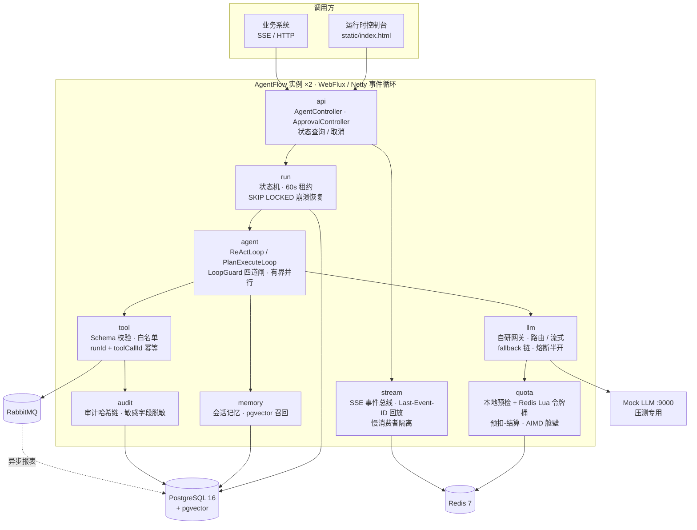
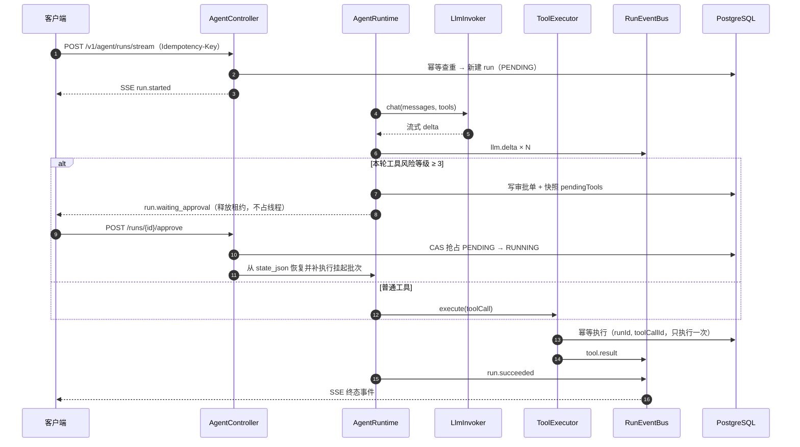

# AgentFlow —— 企业级 Agent 运行时平台

[](https://github.com/qwertyuiop1234561234563/agentflow/actions/workflows/ci.yml)


> 把长任务 Agent 做成**可恢复、可限流、可审批、可观测**的运行时：断线能续、崩溃能捡、重复提交只执行一次、高风险工具必须人工放行。

| 实测指标 | 数值 |
|---|---|
| 单元 + 集成测试 | **208 个全绿**（Testcontainers 拉起真实 PostgreSQL / Redis / RabbitMQ） |
| 限流雪崩修复 | 同场景失败率 **81% → 0%**（20 并发 × 10 轮，200/200 成功） |
| 单实例吞吐 | **5.59 runs/s**，P50 / P95 / P99 = 3045 / 3076 / 3091 ms |
| 资源占用 | 堆上限 **512 MB**，压测期间 0 OOM、0 ERROR |

> 所有数字均为本机 Docker 实测，测试方法与原始数据见 [docs/BENCHMARK.md](docs/BENCHMARK.md)，不做线上集群口径的夸大。

**30 秒跑起来**（需要 Docker）：

```bash
docker compose up -d --build
# 浏览器打开 http://localhost:8080 —— 内置零依赖控制台
```

技术栈：Java 17 · Spring Boot 3.2.10 · WebFlux · MyBatis-Plus · PostgreSQL 16 + pgvector · Redis 7 · RabbitMQ · Resilience4j · Micrometer/Prometheus · Testcontainers · k6

## 架构图



一次 run 的生命周期（含高风险工具的人工审批）：



> 图中每个模块都能在 `src/main/java/cn/com/agentflow/<模块名>` 下找到对应实现。

## 快速开始

前置：Docker 与 Docker Compose；本地 Maven + JDK 17（仅本地开发需要）。

```bash
# 一键起全栈：postgres + redis + rabbitmq + mock-llm + app×2
docker compose up -d --build

# 确认健康
docker compose ps
curl http://localhost:8080/actuator/health

# 发起一次流式 run（逐 token 输出）
curl -N -X POST http://localhost:8080/v1/agent/runs/stream \
  -H 'Content-Type: application/json' \
  -H 'X-Api-Key: demo-key-123456' \
  -d '{"query":"查询 10.0.0.1 这台主机的情况","model":"mock-large"}'
```

本地开发（不用 Docker 起应用）：

```bash
docker compose up -d postgres redis rabbitmq mock-llm
mvn spring-boot:run -Dspring-boot.run.profiles=local
```

## 运行时控制台

应用内置一个零依赖的单页控制台（`src/main/resources/static/index.html`），启动后直接访问：

```
http://localhost:8080/
```

支持：填写任务并实时观察 SSE 事件流、查看 run 状态/耗时/工具调用统计、查看模型输出、
取消 run、断线重连（自动带 `Last-Event-ID` 回放）、以及 `WAITING_APPROVAL` 时的人工审批。
API Key 默认填好演示值 `demo-key-123456`，可在右侧 Connection 卡片中修改并本地保存。
后端未启动时页面自动进入「离线演示模式」，用本地事件流演示完整交互。

## API 示例

```bash
# 异步创建 run（长任务不占连接），立即返回 runId
curl -X POST http://localhost:8080/v1/agent/runs \
  -H 'Content-Type: application/json' -H 'X-Api-Key: demo-key-123456' \
  -H 'Idempotency-Key: 6f1c2b8e-4f6a-4c1e-9d0b-2a7f3c5e8d11' \
  -d '{"query":"汇总最近的高危漏洞","model":"mock-large"}'
# 超时重试请复用同一个 Idempotency-Key：重复提交返回 409(-32009)，不会重复建 run / 重复扣配额

# 断线重连：带 Last-Event-ID 回放未收事件
curl -N http://localhost:8080/v1/agent/runs/{runId}/events \
  -H 'X-Api-Key: demo-key-123456' -H 'Last-Event-ID: 42'

# 查询状态 / 主动取消
curl http://localhost:8080/v1/agent/runs/{runId} -H 'X-Api-Key: demo-key-123456'
curl -X POST http://localhost:8080/v1/agent/runs/{runId}/cancel -H 'X-Api-Key: demo-key-123456'

# 高风险工具（asset_delete）审批
curl -X POST http://localhost:8080/v1/approvals/{approvalId} \
  -H 'Content-Type: application/json' -H 'X-Api-Key: demo-key-123456' \
  -d '{"approved":true,"comment":"确认"}'

# 指标
curl http://localhost:8080/actuator/prometheus
```

完整事件模型与错误码见 `docs/PROTOCOL.md`。

## 压测入口

6 个 k6 场景，全部打 mock-llm，详见 `loadtest/README.md`：

```bash
k6 run loadtest/baseline.js          # 基线：TTFT P95 < 1500ms
k6 run loadtest/agent_multi_turn.js  # 多轮 ReAct：端到端 P95 < 8000ms
ulimit -n 65535 && k6 run loadtest/sse_10k.js   # 1 万 SSE 长连接
k6 run loadtest/quota_burst.js       # 配额突发：429 与预扣结算
k6 run loadtest/backpressure.js      # 背压：慢客户端不 OOM
k6 run loadtest/soak.js              # 浸泡 30 分钟
```

压测铁律：预热 60s、同场景 3 次取中位数、只记 P50/P95/P99、同步记录服务端指标。结果填入 `docs/BENCHMARK.md`，容量推导见 `docs/CAPACITY.md`。

## 文档索引

| 文档 | 内容 |
|---|---|
| `docs/DESIGN.md` | 架构图、模块职责、数据流、补短板表、部署拓扑（含读写分离说明） |
| `docs/AGENT.md` | ReAct 流程、工具协议、上下文预算、记忆、断点续跑、能力对照表 |
| `docs/CONCURRENCY.md` | 并发点清单、连接层、限流、背压、舱壁、线程模型、容量 |
| `docs/PROTOCOL.md` | SSE 事件类型、错误码、重连语义、请求示例 |
| `docs/adr/0001~0006` | 6 篇架构决策记录（每篇含"代价"） |
| `docs/BENCHMARK.md` | 压测环境、6 场景结果、拐点、瓶颈定位 |
| `docs/CAPACITY.md` | 容量公式、实测值代入、扩容建议、上限 |
| `docs/RUNBOOK.md` | 5 条告警的定位命令、处置步骤、升级路径 |
| `docs/SLO.md` | SLI 定义、SLO 目标、错误预算、消耗策略 |
| `docs/MIGRATION.md` | expand-only 规范、并发索引、回滚方式 |
| `docs/RELEASE.md` | 灰度策略、回滚步骤、停机流程 |
| `docs/RESUME.md` | 简历亮点：每条 bullet + 代码位置 + 验证命令 |

## 目录说明

```
agentflow/
├── pom.xml / Dockerfile / docker-compose.yml / .dockerignore
├── docker/init-ro-user.sql          # PG 只读账号（模拟读写分离）
├── .github/workflows/ci.yml         # CI：JDK 17 + mvn verify + k6 smoke
├── loadtest/                        # 6 个 k6 场景 + 压测手册
├── docs/                            # 12 份文档（含 adr/ 6 篇决策记录）
├── mock-llm/                        # 压测专用模拟模型（流式、可控 TPS、工具调用注入）
└── src/main/java/cn/com/agentflow/
    ├── api/ auth/ run/ agent/ tool/ llm/ quota/ stream/
    ├── memory/ cache/ audit/ guard/ metric/ exception/
    ├── config/ entity/ mapper/ util/
    └── src/main/resources/          # application.yml、Flyway V1~V5、Lua、prompts
```

## 端口

| 服务 | 端口 | 说明 |
|---|---|---|
| app1 | 8080 | 应用实例 1 |
| app2 | 8081 | 应用实例 2（容器内仍为 8080） |
| mock-llm | 9000 | 压测专用模拟模型 |
| PostgreSQL | 5432 | pgvector/pg16，max_connections=300 |
| Redis | 6379 | 512MB，allkeys-lru |
| RabbitMQ | 5672 / 15672 | AMQP / 管理台（vhost `/agentflow`） |

## 演示账号

| 用途 | 凭据 |
|---|---|
| API Key | `demo-key-123456`（请求头 `X-Api-Key`） |
| PG 读写账号 | `agentflow` / `agentflow` |
| PG 只读账号 | `agentflow_ro` / `agentflow_ro` |
| RabbitMQ | `agentflow` / `agentflow`（管理台 http://localhost:15672） |

以上仅为本地演示凭据，全部支持环境变量覆盖（`DB_PASSWORD`、`MOCK_API_KEY` 等），生产禁止沿用默认值。

## 常见问题

**1. 客户端断开后 run 还在跑吗？**
默认级联取消：断开即回收模型连接、舱壁信号量与配额预扣，run 转 `CANCELED`。需要"断开继续跑"的长任务，用 `POST /v1/agent/runs` 异步创建，再轮询状态或重新订阅事件（带 `Last-Event-ID`）。

**2. 为什么限流返回 429 但错误码是 -32005？**
HTTP 429 表示被限流，body 中业务码 `-32005` 区分 RPM/TPM 维度；详见 `docs/PROTOCOL.md` 错误码表。

**3. Redis 挂了会怎样？**
限流降级为本地近似限流（本地桶 = 全局/实例数 × 1.2），事件回放不可用（实时流不受影响），可用性优先而非整体失败。

**4. 实例被 kill 后任务怎么办？**
租约 60 秒过期后，`RunRecoveryJob` 用 `SKIP LOCKED` 抢占并从 `state_json` 断点续跑；工具靠 `(run_id, tool_call_id)` 唯一约束保证不重复执行。

**5. 断线重连会丢事件吗？**
重连带 `Last-Event-ID` 可回放最近 500 条 / 30 分钟内的缓存事件；超出窗口请改用 `GET /v1/agent/runs/{runId}` 拉最终状态。这是已知取舍（见 ADR 0005 讨论）。

**6. 压测会打到真实模型吗？**
不会。6 个 k6 脚本全部使用 `mock-large`/`mock-small`，压测铁律第一条即"只打 mock-llm"。
